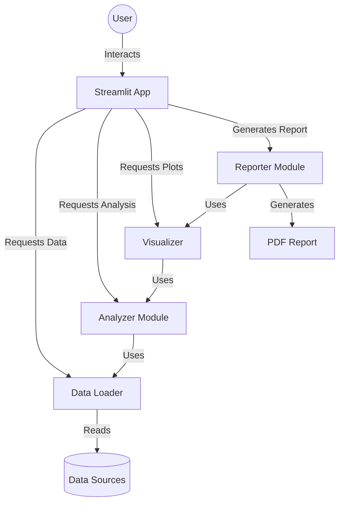

# fveAnalyzator

## Description
This project provides a comprehensive toolkit for analyzing Photovoltaic (PV) power plant feasibility and green subsidy calculations. It includes:

1. **FVE Analyzer** — deep analysis of PV system feasibility for Antelon Energy customers (ROI, NPV, energy flow, economic comparison with other investments).
2. **NZÚ 2026 Calculator** — standalone subsidy calculator for the Czech "Nová zelená úsporám" green program (see [nz2026-calculator/](nz2026-calculator/README.md)).

## Features
- **Energy Flow Analysis**: Analyzes consumption, production, battery usage, and grid interaction.
- **Economic Analysis**: Calculates ROI, NPV, and compares with other investments.
- **Visualization**: Interactive charts using Plotly.
- **PDF Reporting**: Generates comprehensive PDF reports with charts, tables, and analysis summaries.
- **Scenario Planning**: Optimizes PV and battery size.
- **Green Subsidy Calculator**: Standalone NZÚ 2026 calculator for Czech green program subsidies (see [nz2026-calculator/](nz2026-calculator/README.md)).

## Technology Stack
- **Language**: Python 3.12+
- **Frontend**: Streamlit
- **Data Processing**: Pandas, NumPy
- **Visualization**: Plotly, Kaleido
- **Reporting**: WeasyPrint, Jinja2
- **Containerization**: Docker

## Installation

### Local Development
1. Clone the repository.
2. Create a virtual environment:
   ```bash
   python3 -m venv venv
   source venv/bin/activate
   ```
3. Install dependencies:
   ```bash
   pip install -r requirements.txt
   ```
4. Run the application:
   ```bash
   streamlit run src/app.py
   ```

### Docker
1. Build and run the container:
   ```bash
   docker compose up --build
   ```
2. Access the app at `http://localhost:8501`.

## Communication Matrix


