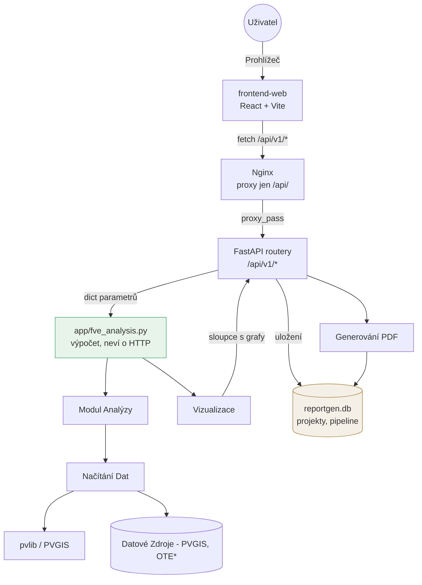

# fveAnalyzator

## Popis / Description

Tento nástroj poskytuje hloubkovou analýzu proveditelnosti realizace fotovoltaické elektrárny (FVE) pro zákazníky Antelon Energy s.r.o. (dříve Rabiav) a zahrnuje:

1. **FVE Analyzer** — deep analysis of PV system feasibility (ROI, NPV, energy flow, ekonomické porovnání).
2. **NZÚ 2026 Calculator** — standalone kalkulačku dotací programu "Nová zelená úsporám" (viz [nz2026-calculator/](nz2026-calculator/README.md)).
3. **ReportGen** — generátor PDF reportů (Antelon Pentagon 16:9 + fveAnalyzator Energy/Economic/OTE).

This project provides a comprehensive toolkit for analyzing PV power plant feasibility and green subsidy calculations.

## Klíčové Funkce

- **Analýza toků energie**: Detailní bilance spotřeby, výroby, využití baterie a interakce se sítí.
- **Ekonomická analýza**:
  - Výpočet návratnosti (ROI), Čisté současné hodnoty (NPV).
  - Porovnání s alternativními investicemi (S&P 500) a scénářem bez FVE (pouze platby za energie).
- **Realistické modelování FVE**:
  - Využívá data **PVGIS TMY (Typical Meteorological Year)** pro konkrétní lokalitu. Křivky výroby tak odpovídají reálným historickým podmínkám (včetně zatažených dní a sezónních výkyvů), nikoliv jen teoretickému ideálu.
  - Konfigurovatelné ztráty systému a zimní penalty.
- **Pokročilá simulace spotřebičů**:
  - **Iterativní Net Surplus**: Spotřebiče jsou spínány sekvenčně na základě čistého dostupného přebytku.
  - **Chytré nabíjení EV**: Podpora strategií (Týdně, Denně, Víkendy) s definovanými kapacitami baterií (např. Jaecoo ~18kWh, Enyaq ~60-80kWh).
  - **Realistický "Fallback"**: Spotřebiče jako pračka a sušička se automaticky spustí ze sítě ve večerních hodinách, pokud nebyla během dne dostatečná výroba FVE.
- **Uložení analýzy**: Výsledek jde uložit jako **rozpracovanou analýzu** (stav `fve_analyza`) s kontaktem na zákazníka, a později jedním kliknutím převést na zakázku, která navazuje na pipeline. Viz [Životní cyklus zakázky](docs/architektura.md#životní-cyklus-zakázky).
- **Hloubková vizualizace**:
  - **Sunburst grafy**: Interaktivní hierarchický rozpad energie a úspor (Celkem -> Vlastní spotřeba -> Spotřebič).
  - **Treemaps**: Vizualizace podílníků na odběru ze sítě.
  - **Vylepšené UI/UX**: Responzivní tabulky, indikátory načítání (spinners) pro dlouhé operace.
- **Reporting**:
  - **PDF**: Generování komplexních PDF reportů (Energetický, Ekonomický, OTE, Antelon Pentagon 16:9).
  - **Excel (XLSX)**: pouze **import** — `Administrace → Import` načte `PROCESNÍ DISPEČINK.xlsx`. *Export* do Excelu neexistuje.

## Použité Technologie

- **Jazyk**: Python 3.12+
- **Frontend**: React 18 + Vite + TypeScript + Tailwind (jediný klient, `frontend-web/`)
- **Backend API**: FastAPI
- **Zpracování dat**: Pandas, NumPy, pvlib
- **Vizualizace**: Plotly, Kaleido, Matplotlib
- **Reporting**: WeasyPrint, Jinja2
- **Kontejnerizace**: Docker, Nginx

> Architektura, cesta požadavku, mapa endpointů a seznam věcí, které
> systém **neumí**, jsou v [docs/architektura.md](docs/architektura.md).

## Instalace a Spuštění

### 1. Docker (Doporučeno)

Nejjednodušší způsob pro spuštění celé aplikace.

1. **Zkontrolujte volné porty** (aktuální compose používá 3000 a 8051 — 8050 je obsazený jiným projektem):

    ```bash
    ss -tln | grep -E "3000|8051"
    ```

2. **Sestavte a spusťte kontejnery:**

    ```bash
    docker compose up --build -d
    ```

3. **Otevřete aplikaci:**
    - Web (React): [http://localhost:3000](http://localhost:3000)
    - Backend API (FastAPI): [http://localhost:8051/docs](http://localhost:8051/docs)

    Výchozí účty (seed při prvním startu, hesla lze změnit v `.env`):

    | Role | E-mail | Heslo | Práva |
    |------|--------|-------|-------|
    | `admin` | `admin@antelon.local` | `Admin123!` | vše + správa uživatelů/spotřebičů |
    | `antelon` | `antelon@antelon.local` | `Antelon123!` | všechny projekty, nahrávání fotek, čistý PDF |
    | `customer` | `zakaznik@antelon.local` | `Zakaznik123!` | jen přiřazené projekty (přes QR/odkaz), čistý PDF |
    | `anonymous` | — | — | teaser `/p/{code}` + PDF s vodoznakem |

    Nastavitelné přes `.env`: `RG_ADMIN_*`, `RG_ANTELON_*`, `RG_CUSTOMER_*`, `RG_JWT_SECRET`, `RG_PUBLIC_URL` (viz `.env.example`). Další uživatelé přes registraci na webu nebo `admin` → `PUT /admin/users/{id}`.

    Přihlašovací jména jsou zdokumentována zde a v `.env.example`.

### 1b. ReportGen — generátor PDF reportů (nový modul)

Nový modul `backend/app/reportgen` + `frontend-web`:

- **Šablona Antelon** (Pentagon v2, 16:9): z CSV Shelly datalogeru (`Fáze A/B/C`, `Celkem`, `Time, V` / `Čas, Wh`, BOM, `0`=chybí). Podporuje 1 i více CSV (více měsíců se sloučí), denní + volitelně hodinový/15min profil. Přímá editace textů a vypínání sekcí, fotogalerie, QR sdílení.
- **Šablony fveAnalyzator**: wrap existujících Energy/Economic/OTE reportů (WeasyPrint).
- **Role**: `admin` (správa uživatelů/spotřebičů), `antelon` (všechny projekty, čistý PDF), `customer` (jen přiřazené projekty, čistý PDF), `anonymous` (teaser náhled `/p/{code}`, PDF s vodoznakem). Blur pro `teaser`/`internal` sekce.
- API: `/api/v1/*` — auth, projekty, upload, data preview, generate, pdf download, share/QR, public preview, OTE, admin.

Viz `docs/superpowers/specs/2026-08-28-reportgen-design.md`.

### 1c. Procesní pipeline (Dispečink)

End-to-end procesní dispečink zakázek (lead → příprava/smlouva → realizace → servis) v modulech `backend/app/reportgen` (pipeline, AI, ekonomika, materiály, fakturace) + `frontend-web` (stránka **Dispečink**).

- **Typy zakázek a šablony**: 11 šablon (`rd`, `byt`, `firma`, `obec`, `bojler`, `rozsireni`, `ostatni`, …) se seedují při startu; admin je vidí a edituje kroky v `Administrace → Šablony`.
- **Import dispečinku**: `Administrace → Import` nahraje `PROCESNÍ DISPEČINK.xlsx` (idempotentně, duplicity se přeskočí). Alternativně `POST /api/v1/admin/import/dispecink`.
- **Tabule zakázek**: `/dispecink` — filtry (typ, stav, text), proužek pipeline u každé zakázky, klikaní do detailu.
- **Pipeline detail**: `/projects/{id}/pipeline` — kroky ve fázích, plánování (datum, odpovědná osoba), přechody (začít/dokončit/odeslat/podepsat/přeskočit/zrušit), brány a podmínky (např. dotace NZÚ, půjčka), paralelní větve; historie událostí.
- **AI kroky**: návrh FVE, baterie, dotace NZÚ (C.3), půjčka, podrobná nabídka — generují se automaticky (`ai_chain`) nebo ručně; výstup musí admin/antelon schválit nebo zamítnout.
- **Finanční efekty**: 2 500 Kč za technické posouzení (faktura při „pokračujeme“, žádná při „Zamítnuto“ → zakázka `cancelled`), sleva −2 500 Kč při podpisu SoD, zálohová/finální faktura.
- **Časové výkazy a montéři**: `Pipeline detail → Časové výkazy` (minuty admin/práce na krok), souhrn, výkaz montérů CSV (`/admin/reports/monteri-csv`).
- **Ekonomika**: náklad admin/work dle sazebníku RateCard (kancelář 500 Kč/h, montáž 450–550 Kč/h), marže z číselníku `settings` (default 30 %) — `Pipeline detail → Ekonomika`. Admin a práce se nikdy nesčítají.
- **Materiály**: číselník (`/materialy`, správa admin/nákupčí) + matice plán/objednávka/výdej/skutečnost po projektu s cenovým snapshotem.
- **Fakturace**: položky dokladů v projektu, vystavení (čísla `inv-{projekt}-{seq}`), stav `issued → paid`.
- **Role a role-switcher**: uživatel může mít více rolí (`/auth/me` vrací `roles`); přepínač rolí v hlavičce. Role: `admin`, `antelon`, `sales`, `designer`, `buyer`, `warehouse`, `subsidy`, `connection`, `electrician`, `roofer`, `inspector`, `customer`.
- **Customer portál**: zákazník přes sdílecí odkaz (`/p/{code}`) vidí stav pipeline a kroky „čeká na vás“ (sběr podkladů, odsouhlasení nabídky, podpis SoD); akce řídí obchodník.
- **Notifikace**: zvonkohra v hlavičce (plánování kroku, čekání na zákazníka, AI chyby).

Viz `docs/superpowers/specs/2026-09-24-procesni-pipeline-design.md` (design) a `docs/superpowers/plans/2026-09-24-procesni-pipeline.md` (plán M1–M6).

### 1d. FVE analýza (přeneseno ze Streamlitu)

Energetická i ekonomická analýza FVE, původně ve Streamlitu, teď v
`frontend-web` + `backend/app/fve_analysis.py`:

- **Dvě místa, jedna komponenta**: `/fve-analysis` (samostatně) a
  `/projects/{id}/fve-analysis` (u existující zakázky). Formulář,
  výsledky i sběr kontaktu jsou sdílené.
- **Kontakt je povinný** v obou případech — jméno, e-mail, telefon, těsně
  před uložením.
- **Rozpracovaná analýza** (`Project` ve stavu `fve_analyza`) vznikne
  uložením. `admin`/`antelon` ji pak jedním kliknutím převede na zakázku
  (`lead`) — pipeline se připojí ze šablony, kroky na které analýza už
  odpověděla se označí jako hotové, a analýza pokračuje v běžném toku.
  Převod je idempotentní.
- **Dostupná i pro roli `customer`** (menu *FVE analýza*), nejen pro
  interní uživatele.
- **Výpočet je v jednom modulu** (`app/fve_analysis.py`) a neví o HTTP —
  mapování chyb na status codes je věc routeru.

Viz [docs/architektura.md](docs/architektura.md#životní-cyklus-zakázky).

### 2. Lokální Vývoj

Běží **dvě věci zároveň** — backend a frontend.

1. **Vytvořte virtuální prostředí a nainstalujte závislosti:**

    ```bash
    python3 -m venv venv
    source venv/bin/activate  # Windows: venv\Scripts\activate
    pip install -r requirements.txt
    ```

2. **Spusťte backend** (z kořene repozitáře):

    ```bash
    uvicorn backend.main:app --reload --port 8000
    ```

3. **Spusťte frontend** (z `frontend-web/`, v druhém terminálu):

    ```bash
    npm install
    VITE_DEV_PROXY_TARGET=http://127.0.0.1:8000 npm run dev
    ```

    > `VITE_DEV_PROXY_TARGET` je nutný: `vite.config.ts` má ve výchozím
    > stavu proxy `/api/v1` na `127.0.0.1:8000`. Když backend pustíte na
    > jiném portu (např. 8051 jako v Dockeru), frontend nebude volat API a
    > uvidíte jen síťové chyby v konzoli prohlížeče.

    Aplikace je na [http://localhost:5173](http://localhost:5173).

**Docker je jednodušší** — `docker compose up --build -d` zvedne obojí
na 3000/8051 bez řešení portů a proxy.

### 3. Nasazení na server (produkce)

Aplikace běží na serveru **drakisa** (192.168.119.167) jako Docker Compose projekt `antelon-energy` v adresáři `/home/roman/apps/antelon-energy`. Veřejně dostupná na **https://fve.etikos.cz** (web na portu 3001 — port 3000 obsazuje Grafana), backend API na 8051.

**Flow nasazení:**

1. Lokálně: commit + `git push origin main`.
2. Na serveru: `cd /home/roman/apps/antelon-energy && ./deploy.sh`
3. `deploy.sh` automaticky:
   - zálohuje produkční `data/reportgen.db` do `data/backups/`,
   - stáhne nejnovější kód (`git pull --ff-only`),
   - znovupostaví a restartuje kontejnery (`docker compose up -d --build`),
   - ověří health backendu a webu.

**Důležité:**

- Produkční data (`reportgen.db`, `data/projects/`, `spot_market.db`) žijí pouze na disku serveru — **nejsou v gitu** a nesmí se přepsat lokální vývojovou verzí.
- Citlivé hodnoty (hesla, `RG_JWT_SECRET`, `RG_PUBLIC_URL=https://fve.etikos.cz`) jsou v `.env` na serveru; v gitu je jen `.env.example`.

## Integrace Dat (Spotové ceny OTE) — není hotovo

**OTE analýza je vědomě odložená.** Endpointy `/ote/update`,
`/ote/status`, `/ote/analyze` a `/report/ote` v `backend/main.py` existují,
ale **nejsou funkční**, protože chybějí skripty, které by stahovala a
zpracovávala data z OTE-CR:

| Očekávaný soubor | Stav |
|---|---|
| `run_ote_update.py` | chybí |
| `download_ote_data.sh` | chybí |
| `process_ote_data.py` | chybí |

Dnešní stav: `GET /ote/status` vrátí `{"status": "empty"}`,
`POST /ote/update` skončí 500, `data/spot_market.db` je prázdná a ve
frontendu OTE není nikde propojené.

Není to bug, ale nedokončená část projektu — skripty je potřeba doplnit.
Podrobnosti v [docs/architektura.md](docs/architektura.md#ote--spotové-ceny).

## Testování

Testy jsou **pytest + FastAPI `TestClient`**, ne E2E. Frontendu chybí
test framework — jeho bránkou je `npm run build` (`tsc -b && vite build`).

Pozor: build **nepozná**, že se graf v prohlížeči nevykreslí. Plotly je
ořezaný na jen použité typy grafů (viz
[docs/architektura.md](docs/architektura.md#plotly-partial-bundle)), což je
tichý failure mód. Změny v grafech se proto musí ověřit v prohlížeči;
registraci typů hlídá `tests/test_plotly_traces.py`.

```bash
# venv
source venv/bin/activate

# všechny testy (~4 minuty, 154 testů)
pytest tests/

# jen rychlé testy API a úklidu
pytest tests/reportgen/test_fve_api.py tests/reportgen/test_legacy_removal.py \
  tests/reportgen/test_module_loading.py tests/test_plotly_traces.py
```

Testy nepotřebují běžící aplikaci ani síť a nesahají na vývojovou
databázi — každý dostává vlastní dočasnou SQLite. Dvě věci, které je
třeba vědět, když něco selhává:

- **Používejte souřadnice z `data/weather_cache.db`** (v dev cache jsou
  Praha 50.0880 / 14.4208 a Ústí nad Labem 50.6607 / 14.03227).
  Jakákoli jiná lokalita jde na síť k PVGIS a test timeoutuje.
- **Testy jsou záměrně neosazené.** Spotřební data se generují s
  `np.random.normal(0, 0.1)`, takže dva běhy se liší o ~0.005 %. Aserce
  mají rezervu řádově 10⁴ nad tímto šumem.

Podrobnosti a přehled, co který soubor testů pokrývá, jsou v
[docs/architektura.md](docs/architektura.md#testy).

## Architektura (Komunikační Matice)

Jediný klient je `frontend-web` (React). Nginx z něj propouští **jen
`/api/`** na backend — nic jiného na veřejný web nevede.



`*` OTE je odložené — viz [Integrace Dat](#integrace-dat-spotové-ceny-ote--není-hotovo).

Úplný popis — cesta požadavku, mapa endpointů, životní cyklus zakázky
a seznam věcí, které systém neumí — je v
[docs/architektura.md](docs/architektura.md).
