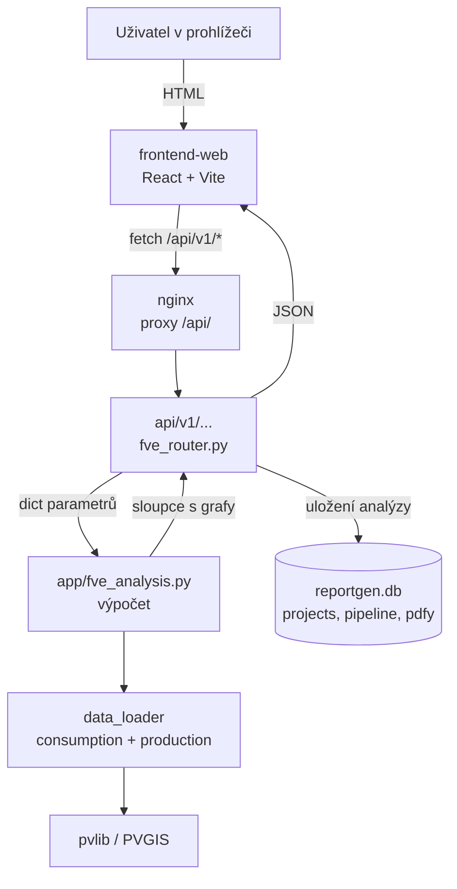

# Architektura

Jak je fveAnalyzator složený dnes — po odstranění legacy Streamlitu
(2026-10-01). K této kapitole patří i [README](../README.md), kde je
instalace a spuštění; sem patří to, co se z README vytratí, jakmile někdo
něco upraví.

Dokumentace se dá číst dvěma směry: **co systém je** (první dvě sekce)
a **co systém není a proč** (poslední sekce).

---

## Jeden frontend

Aplikace má **jediného klienta**: `frontend-web` (React 18 + Vite +
TypeScript + Tailwind). Kombinace komponent sdílená mezi routy
`/fve-analysis` a `/projects/{id}/fve-analysis` je záměrná — analýza
naběhne buď samostatně, nebo uvnitř existující zakázky, a formulář,
výsledky i sběr kontaktu jsou pokaždé stejné.

Legacy Streamlit frontend byl odstraněn 2026-10-01. Jeho zdrojový kód
nebyl v repu nikdy (adresář měl 0 tracknutých souborů), takže šlo o
mrtvou službu v `docker-compose.yml`, která navíc padala s
`File does not exist: app.py`. Odstranění si vzalo i endpointy
`/analysis/*` a `/report/*` — viz níže.

### Proč to nginx nešlo obejít

`frontend-web/nginx.conf` proxyuje **jen** `/api/`:

```nginx
location /api/ {
    proxy_pass http://backend:8000/api/;
}
location / {
    try_files $uri $uri/ /index.html;
}
```

Legacy endpointy tedy nebyly přes veřejný web dosažitelné nikdy — žádná
verejná cesta k nim nevedla. A neměly autentizaci, takže byly dosažitelné
z libovolného místa, kde je port 8051 otevřený.

---

## Kde žije logika analýzy

**`backend/app/fve_analysis.py` je jediné místo, kde je výpočet.** Má
čtyři veřejné funkce a neví nic o HTTP:

| Funkce | K dělá |
|---|---|
| `default_params()` | Výchozí parametry pro UI (bez `active_appliances_data`) |
| `analysis_param_keys()` | Klíče, které `run_energy_analysis` čte — pro filtrování uloženého JSONu |
| `appliance_catalog()` | Spotřebiče z `ApplianceManager`, UI si je načítá, nehardcoduje |
| `run_energy_analysis(params)` | Energetická analýza |
| `run_economic_analysis(params)` | Ekonomická analýza |

Modul o HTTP **nepochce vědět** — mapování chyb na HTTP status codes
dělá tenká vrstva routeru (`backend/app/reportgen/fve_router.py`).
Jde to vidět i v testech: `tests/reportgen/test_legacy_removal.py`
hlídá, že `fve_analysis.py` neimportuje `fastapi`. Kdyby se tam někdy
vrátilo `HTTPException`, test by to odhalil.

`ValueError` z PVGIS (nepodařilo se dohledat data pro zadané
souřadnice) propadá z výpočtu ven; router z něj udělá 400.

### Kdo volí správné importy

Do `app.fve_analysis` se moduly načítají líně přes `_mod()`, protože
původně existovaly dvě cesty importu (`app.analyzer` v kontejneru vs.
`analyzer` při volání ze stránek). Volající si musejí pamatovat, že jde
o `app.` prefix:

```python
from app.fve_analysis import run_energy_analysis   # v kontejneri / v main.py
```

Testy si dávají na `sys.path` `backend/app`, takže v `tests/` jde
`from reportgen import ai_service`.

---

## Cesta požadavku



Klíčové: **šipka jde z routeru do výpočtu jako obyčejný dict a zpět**.
Žádné pydantic schema mezi nimi, žádný HTTP round-trip uvnitř procesu.

---

## Životní cyklus zakázky

Projekt (`projects`) má pět stavů. `fve_analyza` přibyl 2026-10-01 spolu
s FVE analýzou — je to rozpracovaná analýza, která ještě není zakázkou,
ale už má uložené parametry a kontakt.

```
   (nový)
     │
     ▼
 ┌───────────────┐   convert-to-order   ┌────────┐
 │  fve_analyza  │ ───────────────────► │  lead  │
 │ rozpracovaná  │                      └────┬───┘
 │   analýza     │                           │
 └───────────────┘                           ▼
                                        ┌────────┐
                                        │ active │◄──┐
                                        └────┬───┘   │
                                             │       │ obnovení
                                             ▼       │
                                       ┌───────────┐   │
                                       │ cancelled │───┘
                                       └───────────┘
```

### Jak vznikne analýza

**Samostatně** — `/fve-analysis`, k dispozici i pro roli `customer`.
Uživatel vyplní parametry, vidí výsledky a grafy, a teprve když je
výsledek dobrý, klikne na *Uložit*. Tím se vytvoří `Project` ve stavu
`fve_analyza`.

**Uvnitř zakázky** — `/projects/{id}/fve-analysis`. Parametry se ukládají
do `projects.fve_params_json` existujícího projektu; jméno projektu se
nemění. Zabrání tomu `PUT /api/v1/projects/{id}/params`, která je
admin/antelon only.

### Sběr kontaktu

Kontakt se vyžaduje **v obou případech**, těsně před uložením
(jméno, e-mail, telefon). Rozdíl je v tom, kam jde:

| | Samostatná analýza | V rámci zakázky |
|---|---|---|
| `projects.customer_email` / `customer_phone` | vyplní se nově | vyplní se nově |
| `owner_id` | kdo uložil | kdo uložil |
| vazba na zákazníka | uživatel se najde/přidá podle e-mailu, jde do `project_users` | beze změny — zákazník už existuje |

Telefon se validuje podle **počtu číslic**, ne podle délky řetězce:
`+420 777 123 456` má 16 znaků, ale 9 číslic. `min_length` by naopak
prošel devět mezer. Vlastní česká hláška přebíjí pydantic
`string_too_short`.

Adresa zákazníka patří na `projects`, ne na `users`: jeden zákazník může
mít několik zakázek s různými kontakty a v tabulce `users` není sloupec
na telefon.

### Převod na zakázku

`POST /api/v1/projects/{id}/convert-to-order` (admin/antelon):

1. zkopíruje `fve_params_json` → `antelon_params_json`,
2. připojí pipeline ze šablony podle typu projektu,
3. přepne `status` na `lead`,
4. označí kroky, na které analýza už odpověděla, jako `done`.

**Idempotentní** — druhý pokus vrátí 409, ne druhou zakázku. Krok se
označuje **prefixem** názvu, ne přesnou shodou: krok se jmenuje
`první indikativní nabídka dle telefonátu - tel/email`, a porovnávání
prefixem přežije přejmenování. (Přesná shoda navíc selhala, protože
název kroku žije v `PipelineStep.name`, ne v `ProjectStep`.)

Typ `ostatni` zůstává výchozí — v okamžiku uložení nikdo neví, jestli je
to dům, firma nebo retrofit. Typ se dá změnit později.

---

## Mapa endpointů

Všechno pod `/api/v1` má autentizaci. Bez ní jsou jen veřejné čtení
(`/p/{code}`) a to je záměr.

### FVE analýza

| Metoda | Cesta | K čemu |
|---|---|---|
| POST | `/fve-analysis/run` | Energetická analýza → výsledky + grafy |
| POST | `/fve-analysis/economic` | Ekonomická analýza |
| POST | `/fve-analysis/geocode` | Adresa → GPS souřadnice |
| GET | `/fve-analysis/appliances` | Katalog spotřebičů |
| POST | `/fve-analysis` | Uložit analýzu jako projekt (se sběrem kontaktu) |
| POST | `/fve-analysis/report/energy` | PDF energetického reportu |
| POST | `/projects/{id}/convert-to-order` | Převod rozpracované analýzy na zakázku |

### Zakázky a pipeline

`/api/v1/projects*`, `/api/v1/pipeline/*`, `/api/v1/admin/*` — viz
[príručku procesní pipeline](superpowers/prirucka-procesni-pipeline.md).

### Veřejné

| Metoda | Cesta | K čemu |
|---|---|---|
| GET | `/p/{code}` | Teaser pro zákazníka přes sdílecí odkaz |

### Bez `/api/v1` (mimo reportgen)

| Metoda | Cesta | Stav |
|---|---|---|
| GET | `/` | Health check |
| POST/GET | `/ote/update`, `/ote/status`, `/ote/analyze` | **Nefunkční** — viz níže |
| POST | `/report/ote` | PDF z OTE výsledku |

---

## Kde jsou data

| Soubor | Co v něm | Pozor |
|---|---|---|
| `data/reportgen.db` | Projekty, pipeline, kroky, PDF verze, uživatelé | Jediný zdroj pravdy. Zálohuje se do `data/backups/` |
| `data/weather_cache.db` | Cache počasí pro výpočet výroby | **V dev prostředí má jediný záznam** (50.0880 / 14.4208). Jakákoli jiná lokalita čte dál ze sítě (PVGIS) — a v testech to znamená timeout |
| `data/spot_market.db` | Spotové ceny OTE | Prázdná — skripty chybí |
| `data/projects/<id>/` | Nahrané soubory projektu (CSV Shelly, fotky) | |
| `data/pdfs/` | Vygenerované PDF | |

`projects.fve_params_json` drží parametry analýzy,
`antelon_params_json` drží parametry, se kterými se zakázka napouští do
reportu. Při převodu se kopírují.

Soubory v `data/` **nejsou v gitu** a nesmí se přepsat lokální
vývojovou verzí — viz README, sekce Nasazení.

---

## Mimo rozsah a známé mezery

Tady je to, co systém **neumí**, aby nikdo netrávil čas hledáním.

### OTE — spotové ceny

`/ote/update`, `/ote/status`, `/ote/analyze` a `/report/ote` v `main.py`
zůstaly, ale **nejsou funkční**: chybějí skripty, které volají
(`download_ote_data.sh`, `process_ote_data.py`, `run_ote_update.py` —
žádný z nich v repu není). `/ote/status` vrátí `{"status": "empty"}`,
`/ote/update` skončí 500.

Účel je záměrný: endpointy ukazují, kam až analýza sahá, a až budou
skripty k dispozici, stačí je doplnit. Ve frontendě je OTE zatím
nepropojený.

### XLSX

Neexistuje **export** do Excelu. Co existuje, je **import**:
`Administrace → Import` čte `PROCESNÍ DISPEČINK.xlsx` přes openpyxl.
README to dřív tvrdilo obráceně.

### Ukládání nastavení do JSON souboru

Neexistuje. Parametry se ukládají jako `Project` — to je i cesta, kterou
se analýza dostane do pipeline. Stahování `.json` jako souboru není
součástí aplikace.

### `main.py` importuje oba reportgen routery v jednom `try`

```python
try:
    from app.reportgen.router import router as reportgen_router
    from app.reportgen.fve_router import router as fve_router
    ...
except Exception as e:
    print(f"ReportGen init failed: {e}")
```

Když spadne jeden, zmizí **oba** — a chyba se vyjede jen do stdout
kontejneru, ne do odpovědi ani do logu s úrovní. Tak se to projevilo,
když chyběla závislost `email-validator`: vypadalo to jako „API neexistuje“,
přičemž příčina byla jinde. Oprava je rozdělit na dva `try` bloky.
Zapsáno jako Ruling 4 v `.superpowers/sdd/2026-10-01-fve-analysis/progress.md`;
záměrně neprovedeno, protože je mimo rozsah této práce.

### Reportgen routery v `main.py`

`main.py` (176 řádků) má vedle reportgen routerů ještě health check a
zbytky OTE. OTE sem patří dočasně — až se doplní skripty, má smysl
vyextrahovat do `app/reportgen/ote_router.py` jako pátý router. Dnes by
to byla kosmetika bez přínosu.

### Reset hesla

Neexistuje. Heslo jde změnit přes `PUT /api/v1/admin/users/{id}`.

---

## Testy

```bash
pytest tests/            # 143 testů, ~4 minuty
```

**Pytest + FastAPI `TestClient`, žádný E2E framework.** Playwright je v
`requirements.txt` a prohlížeče se dají doinstalovat, ale **žádný
Playwright test v repu není** — README to dřív tvrdilo jinak a odkazoval
na neexistující `tests/test_e2e.py`.

Testy nesmějí sahat na vývojovou databázi. `conftest.py` dává na
`sys.path` `backend/app` i `backend/` (aby šlo resolvovat `app.fve_analysis`,
který patchuje `test_ai.py`) a každý test dostává vlastní dočasnou SQLite
databázi.

**Testy jsou záměrně neosazené.** `load_consumption_data` používá
`np.random.normal(0, 0.1)`, takže dva běhy se liší o ~0.005 %. Všechny
aserce mají rezervu řádově 10⁴ nad tímto šumem — neosazovat to je
záměrná volba, ne nedopatření.

Testy navíc musí používat souřadnice z `weather_cache.db` (50.0880 /
14.4208). Jakákoli jiná lokalita jde na síť a timeoutuje.

### Který test hlídá co

| Soubor | Co pokrývá |
|---|---|
| `test_fve_analysis.py` | Výpočet: struktura výsledku, defaulty, katalog spotřebičů |
| `test_fve_api.py` | Všech 7 endpointů, včetně převodu na zakázku |
| `test_project_contact.py` | Migrace sloupců kontaktu a model |
| `test_legacy_removal.py` | Co po úklidu zbylo, co zmizelo, a že OTE zůstal |
| `test_ai.py` | AI kroky pipeline (fve_size, battery, subsidy, loan, nabídka) |
| `test_hardening.py` | Autorizace, izolace projektů, branice v pipeline |
| `test_economy.py`, `test_workflow.py`, `test_import.py`, `test_models.py`, `test_m5_admin_api.py` | Ekonomika, workflow, import dispečinku, modely, admin API |

Fronta nemá test framework — gate je `npm run build` (`tsc -b && vite build`).

---

## Frontend: co kde je

| Soubor | K čemu |
|---|---|
| `src/api/fve.ts` | HTTP klient + `DEFAULT_FVE_PARAMS` (**musí odpovídat `_DEFAULTS` v `fve_analysis.py`**) |
| `src/components/fve/FveAnalysisForm.tsx` | Formulář parametrů |
| `src/components/fve/FveAnalysisResults.tsx` | Výsledky a grafy |
| `src/components/fve/ContactStep.tsx` | Sběr kontaktu před uložením |
| `src/components/PlotlyChart.tsx` | Plotly — `pio.to_json()` vrací **řetězec**, takže se `JSON.parse()`uje |
| `src/pages/FveAnalysis.tsx` | `/fve-analysis` (samostatně) |
| `src/pages/ProjectFveAnalysis.tsx` | `/projects/{id}/fve-analysis` (v rámci zakázky) |

`FveAnalysisForm`, `FveAnalysisResults` a `ContactStep` jsou sdílené
oběma routami. `ContactStep` v režimu „v rámci zakázky“ zapisuje jen
`fve_params` a `contact_*` — **nikdy** nepřepisuje `Project.name`.